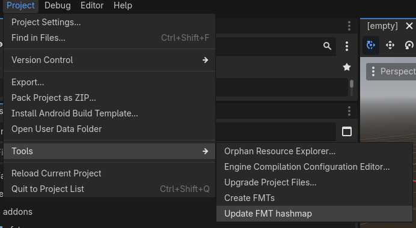

# FMT Files


An `FMT` is a `Fate MaTerial` file. `FateMap` uses these files to store the info of any material a mesh can be given or loaded which the maploader and maker use to track and manage materials and texture options for a given map.

To add a new FMT to your project that the mapmaker can see, in your game project, add the ```.fmt``` file anywhere inside the ```FateMap/Imported/materials``` folder.
The format is shown below.
```
name = NONE
material = Materials/Default/defaultMaterial.material
texture = Materials/Default/None.png
parameters = {}
tags = []
```

```name``` is the name of the material as shown in the mapmaker

```material``` can be a ```ShaderMaterial``` ```StandardMaterial``` or any other godot material.

```texture``` is both the image shown in the mapmaker and the texture that is used as the ```albedo_texture``` of any materials.

```parameters``` contains special info/additional parameters for the material (I.E. a `step_sound = step_sound_file_path.wav`)

```tags``` are a tag used by the editor for setting if a material is skipped when compiling for rendering and/or collision.

all paths inside an FMT are read as relative to the ```Imported``` folder.

## Setting up for usage
An FMT file works in the mapmaker(NOT THE MAPLOADER) regardless of if the Hashmap file is updated or not. to update the hashmap under Project>Tools you'll see `update FMT hashmap`. It will get all fmt files and map their hash to their locations.



This step is necessary anytime you add a new FMT file to allow the maploader to access them.