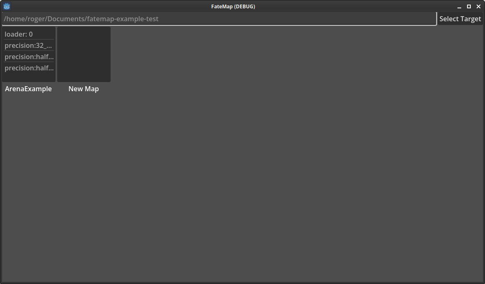

# MapMaker

## Setup
[MapMaker Repository](https://github.com/RogerRandomDev/fatemap)

After installing and launching, you'll see a top bar. Select the folder of another Godot project with the [maploader](../Loader/maploader.md) added to it.
If it has any maps in ```FateMap/maps/Editing``` they will show up. If not you will only see `New Map`.

Make sure your target project has been set up as well. [setting up a project](../Loader/maploader.md#setup)

### Map files

The mapmaker is meant as a frontend to creating/modifying maps ```.FMPE``` files. A compiled map becomes a ```.fatemap``` and is a different format.
```.FMPE``` files keep the full data and are a larger file size than ```.fatemap``` files. ```.fatemap``` files remove unneeded data that is only required during editing to reduce load time and file size.