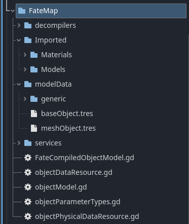

# MapLoader

The maploader for FateMaps is a set of resources you drag and drop into your project to allow the mapmaker to create maps for it.

## Setup

Once you install and add them to your project they should appear as follows.




Any 3d models you intend to place on a map using the map maker are placed into the Models folder.
Any textures/materials you intend to apply to the map in the mapmaker should be placed into Materials folder. You must create a .FMT file for the mapmaker to use them. [FMT](#FMT files)


### FMT files

An fmt file is a Fate Material file containing the info the maploader and maker use to track and manage materials and texture options for a given map.
The format is shown below.
```
name = NONE
material = Materials/Default/defaultMaterial.material
texture = Materials/Default/None.png
parameters = {}
tags = []
```

